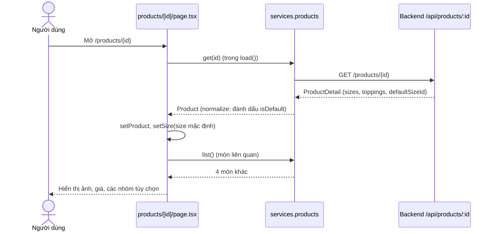
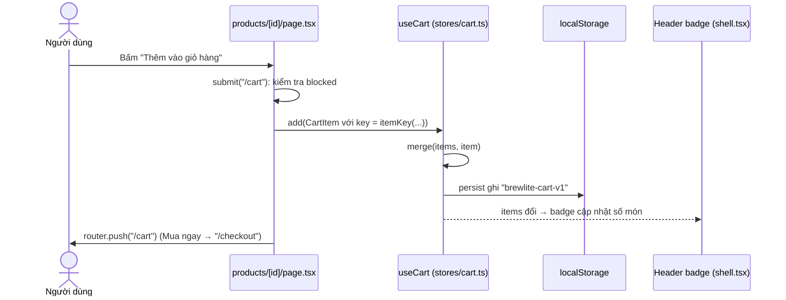
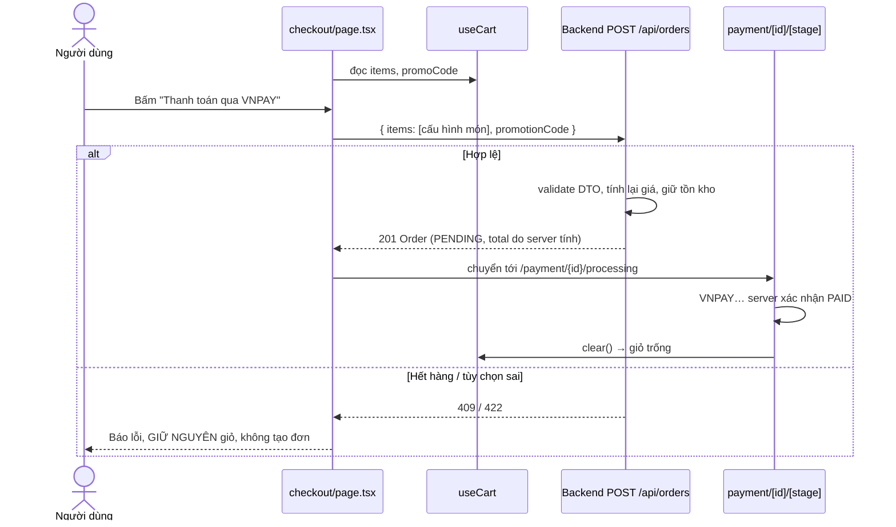

# Luồng hoạt động: Xem chi tiết sản phẩm & Quản lý giỏ hàng

Tài liệu đi theo **từng bước người dùng thao tác** và chỉ ra code nào chạy ở mỗi bước. Đọc kèm mã nguồn để hiểu nhanh nhất. Phần cài đặt/chạy thử xem `docs/CART_PRODUCT_DETAIL_GUIDE.md`.

## 0. Nhìn nhanh

```
 Trang chủ ──click món──► Trang chi tiết ──Thêm vào giỏ──► Store Zustand ──► localStorage
 (app/page.tsx)           (app/products/[id])               (stores/cart.ts)   "brewlite-cart-v1"
                                  ▲                               │
                    GET /api/products/:id                         ├──► Badge header (components/shell.tsx)
                                                                  ├──► Trang giỏ (app/cart/page.tsx)
                                                                  └──► Checkout (app/checkout/page.tsx)
                                                                             │
                                                                   POST /api/orders (items, không giá)
                                                                             │
                                                                   Backend tính giá → đơn PENDING
                                                                             │
                                                                   Thanh toán → PAID → clear() giỏ
```

Ba ý cần nhớ:

| # | Ý chính | Hệ quả |
|---|---|---|
| 1 | Giỏ hàng **chỉ nằm trong trình duyệt** (Zustand + localStorage) | Không có API giỏ; refresh không mất; đổi máy thì mất |
| 2 | Giá trong giỏ **chỉ để hiển thị** | Backend tự tính lại giá khi tạo đơn |
| 3 | Mỗi dòng giỏ được nhận diện bằng **`key` cấu hình** | Cùng cấu hình → cộng số lượng; khác cấu hình → dòng mới |

---

## 1. Dữ liệu dùng trong luồng

### 1.1. `Product` — lấy từ backend (`types/domain.ts`)

```ts
{
  id: "31a650c7-...-000000000001",
  name: "Bạc xỉu 3 tầng Sài Gòn",
  price: 29000,                     // giá gốc (size S)
  stock: 40,                        // tồn kho
  sizes: [
    { code: "S", name: "Nhỏ (S)", extraPrice: 0,    available: true },
    { code: "M", name: "Vừa (M)", extraPrice: 4000, available: true, isDefault: true },
    { code: "L", name: "Lớn (L)", extraPrice: 9000, available: true }
  ],
  toppings: [{ id: "uuid-kem-cheese", name: "Kem cheese", extraPrice: 6000, available: true }, ...],
  ...
}
```

### 1.2. `CartItem` — một dòng trong giỏ

```ts
{
  key: "31a650c7-...|M|uuid-kem-cheese|70% đá|50% ít ngọt|ít sữa",  // khóa cấu hình
  productId: "31a650c7-...",
  name: "Bạc xỉu 3 tầng Sài Gòn",
  imageUrl: "/...",
  size: "M",
  toppingIds: ["uuid-kem-cheese"],
  toppingNames: ["Kem cheese"],
  unitPrice: 39000,                  // 29.000 + 4.000 + 6.000 (chỉ để hiển thị)
  quantity: 2,
  ice: "70% đá",
  sugar: "50% ít ngọt",
  note: "ít sữa",
  sizeOptions: [ ...3 size... ]      // để đổi size ngay trong giỏ
}
```

### 1.3. Khóa cấu hình `itemKey` (`types/domain.ts`)

```ts
itemKey(productId, size, toppingIds, ice, sugar, note)
  = [productId, size, toppingIds.sort().join(","), ice, sugar, note.trim()].join("|")
```

- Topping được **sắp xếp** → chọn "Kem cheese rồi Thêm espresso" hay ngược lại vẫn ra cùng khóa.
- Chỉ cần khác **một** yếu tố (size, topping, đá, đường, ghi chú) là khóa khác → dòng khác.

### 1.4. Thứ được lưu trong localStorage

```json
{
  "state": { "items": [ /* CartItem[] */ ], "promoCode": "BREW10" },
  "version": 2
}
```

---

## 2. Luồng A — Mở trang chi tiết sản phẩm

**Người dùng:** ở trang chủ bấm vào ảnh hoặc nút "Tùy chỉnh …" → đi tới `/products/{id}`.



Các bước trong code:

1. `use(params)` lấy `id` từ URL.
2. `load()` gọi `services.products.get(id)`:
   - Thành công → `setProduct(p)` và chọn sẵn size có `isDefault`.
   - Lỗi mạng/server → `setError` → hiện `ErrorState` có nút **Thử lại** (gọi lại `load`).
   - Backend trả 404 → service trả `null` → hiện "Không tìm thấy sản phẩm".
3. Effect thứ hai gọi `services.products.list()` để lấy 4 món "Có thể bạn sẽ thích".
4. Trong lúc chờ → hiện `<Loading />`.

`services.products` là `apiProducts` (chế độ `api`/`hybrid`) hoặc `mockProducts` (chế độ `mock`), chọn trong `services/index.ts`.

---

## 3. Luồng B — Tùy chỉnh món và tính giá

Mọi lựa chọn là **state cục bộ của trang** (`useState`), chưa đụng tới giỏ:

| State | Đổi khi | Mặc định |
|---|---|---|
| `size` | bấm thẻ Size S/M/L | size `isDefault` (seed: M) |
| `selected` | tick/bỏ tick topping | `[]` |
| `ice`, `sugar` | bấm nút mức đá/đường | `100% đá`, `100% chuẩn` |
| `note` | gõ ghi chú (≤ 120 ký tự) | `""` |
| `quantity` | nút − / + | `1` |

Mỗi lần state đổi, React render lại và **tính lại** các giá trị sau:

```ts
unit      = product.price + chosenSize.extraPrice + Σ chosenToppings.extraPrice
tổng      = unit * quantity

invalid   = size không bán được || có topping tạm hết
inCart    = tổng quantity các dòng CÙNG productId đang có trong giỏ
overStock = inCart + quantity > product.stock
blocked   = !product || invalid || overStock      // → khóa 2 nút mua
```

Ví dụ (Bạc xỉu trong seed): giá gốc 29.000, size M (+4.000) và Kem cheese (+6.000), số lượng 2 → `unit = 39.000`, tổng **78.000 ₫**.
Nếu `stock = 40` và giỏ đã có 39 phần món này → chọn 2 thì `overStock` → nút khóa, hiện *"Chỉ còn 40 phần (giỏ đã có 39 phần)."*

---

## 4. Luồng C — Thêm vào giỏ

**Người dùng:** bấm **Thêm vào giỏ hàng** (hoặc **Mua ngay**).



Chi tiết:

1. `submit(next)` dừng ngay nếu `blocked`.
2. Dựng `CartItem` từ state của trang: `key = itemKey(product.id, size, selected, ice, sugar, note)`, `unitPrice = unit`, `sizeOptions = product.sizes`…
3. Gọi `add(item)` của store. Bên trong là `merge`:
   ```ts
   // đã có dòng cùng key → cộng số lượng (tối đa 99)
   // chưa có            → thêm dòng mới vào cuối
   ```
4. Middleware `persist` tự ghi `items` + `promoCode` xuống localStorage.
5. Mọi component đang đọc `useCart` (badge header, trang giỏ…) tự render lại.
6. Điều hướng: **Thêm vào giỏ hàng** → `/cart`; **Mua ngay** → `/checkout`.

**Thêm nhanh** (mục món liên quan) — `quickAdd(p)`: dùng size mặc định, không topping, `100% đá`, `100% chuẩn`, số lượng 1; vẫn kiểm `đã có trong giỏ + 1 ≤ stock`; ở lại trang và đổi nút thành "Đã thêm".

### Ví dụ gộp dòng

| Lần | Thao tác | Kết quả giỏ |
|---|---|---|
| 1 | Bạc xỉu, M, Kem cheese, 70% đá, SL 2 | 1 dòng, SL 2 |
| 2 | Lặp lại **đúng** cấu hình, SL 1 | 1 dòng, SL **3** |
| 3 | Như trên nhưng **30% đá** | **2 dòng** |

---

## 5. Luồng D — Quản lý giỏ hàng (`/cart`)

Trang giỏ đọc `items`, `promoCode` và các hàm từ `useCart()`. Mọi thao tác **chạy tức thì trên máy**, không gọi server.

| Người dùng làm | UI gọi | Store xử lý |
|---|---|---|
| Bấm + / − | `setQuantity(key, n)` | Đặt số lượng, kẹp trong 1–99 |
| Đổi size ở dropdown | `changeSize(key, size, unitPrice)` | Xem 5.1 |
| Bấm thùng rác | `remove(key)` | Lọc bỏ dòng có `key` đó |
| Bấm **Xóa tất cả** (xác nhận) | `clear()` | `items = []`, `promoCode = ""` |
| Nhập mã + **Áp dụng** | `services.promotions.validate` → `setPromoCode` | Lưu mã |

Sau mỗi thao tác: store đổi → localStorage được ghi → trang giỏ, badge, tổng tiền render lại.

### 5.1. Đổi size trong giỏ

```
Giỏ:   [A] Bạc xỉu S, 100% đá, SL 1     [B] Bạc xỉu M, 100% đá, SL 2

Đổi [A] sang M:
  1. Đơn giá mới = đơn giá cũ − phụ thu S + phụ thu M    (tính ở SizeControl)
  2. key mới = itemKey(..., "M", ...)  → TRÙNG key của [B]
  3. Gộp: xóa [A], [B] tăng lên SL 3

Nếu key mới không trùng dòng nào → giữ nguyên vị trí dòng, chỉ đổi size/giá/key.
```

### 5.2. Tính tiền

```ts
Thành tiền dòng = unitPrice * quantity          // lineTotal
Tạm tính        = Σ thành tiền các dòng         // cartTotal
Giảm giá        = min(promotion.discount, Tạm tính)
Tổng cộng       = Tạm tính − Giảm giá
```

Mã ưu đãi đã lưu được **kiểm tra lại mỗi khi Tạm tính đổi**; không còn hợp lệ thì tự bỏ và báo lỗi.

### 5.3. Cảnh báo tồn kho

1. Khi mở trang, gọi `services.products.list()` để có `stock` từng món.
2. `stockIssue(item)`: cộng `quantity` mọi dòng cùng `productId`; vượt `stock` → trả thông báo.
3. Dòng vượt kho hiện chữ đỏ *"X chỉ còn N phần"* / *"X đang hết hàng"*.
4. Còn dòng vượt kho (`hasIssue`) → **khóa nút Tiến hành đặt hàng**.

### 5.4. Bấm "Tiến hành đặt hàng"

- Chưa đăng nhập → `/login?next=%2Fcheckout` → đăng nhập/đăng ký xong quay lại `/checkout`.
- Đã đăng nhập → `/checkout`.
- **Giỏ không đổi** khi đăng nhập, đăng ký hay đăng xuất (giỏ thuộc trình duyệt, không thuộc tài khoản).

---

## 6. Luồng E — Từ giỏ đến đơn hàng



Body thực tế (`services/api.ts` → `apiOrders.create`):

```json
{
  "items": [{
    "productId": "31a650c7-...", "size": "M", "toppingIds": ["uuid-kem-cheese"],
    "quantity": 2, "ice": "70% đá", "sugar": "50% ít ngọt", "note": "ít sữa"
  }],
  "promotionCode": "BREW10"
}
```

- **Không gửi `unitPrice`** → sửa giá trong localStorage cũng không ảnh hưởng tiền đơn.
- Người đặt lấy từ **cookie JWT**, không lấy từ body.
- Giỏ chỉ bị xóa khi đơn đã **PAID**; thanh toán thất bại/hủy → giỏ còn nguyên để thử lại.

---

## 7. Luồng F — Vòng đời dữ liệu giỏ trong trình duyệt

| Thời điểm | Điều xảy ra |
|---|---|
| Lần đầu vào web | localStorage trống → `items = []` |
| Thêm/sửa/xóa | `persist` ghi lại `brewlite-cart-v1` ngay |
| Refresh / mở lại tab | `persist` đọc localStorage → khôi phục `items`, `promoCode` |
| Dữ liệu dạng cũ (version 1, thời còn giỏ server) | `migrate` tính lại `key`, bỏ trường thừa, gộp dòng trùng → version 2 |
| Đơn PAID | `clear()` → giỏ trống |
| Xóa dữ liệu trình duyệt / đổi máy | Mất giỏ (đơn hàng vẫn còn trên server) |

---

## 8. Bảng tra nhanh: hành động → code

| Hành động | File | Hàm / biến |
|---|---|---|
| Tải chi tiết món | `app/products/[id]/page.tsx` | `load()` → `services.products.get` |
| Tính đơn giá | `app/products/[id]/page.tsx` | `unit` |
| Kiểm tồn kho trước khi thêm | `app/products/[id]/page.tsx` | `inCart`, `overStock`, `blocked` |
| Thêm vào giỏ / Mua ngay | `app/products/[id]/page.tsx` | `submit()` → `useCart.add` |
| Thêm nhanh | `app/products/[id]/page.tsx` | `quickAdd()` |
| Tạo khóa cấu hình | `types/domain.ts` | `itemKey()` |
| Gộp dòng trùng | `stores/cart.ts` | `merge()` |
| Đổi số lượng | `stores/cart.ts` | `setQuantity()` + `clampQuantity()` |
| Đổi size trong giỏ | `app/cart/page.tsx` → `stores/cart.ts` | `SizeControl` → `changeSize()` |
| Xóa / xóa tất cả | `stores/cart.ts` | `remove()`, `clear()` |
| Lưu localStorage | `stores/cart.ts` | `persist({ name: "brewlite-cart-v1", version: 2, migrate })` |
| Badge số món | `components/shell.tsx` | `count = Σ quantity` |
| Tổng tiền | `types/domain.ts` | `lineTotal()`, `cartTotal()` |
| Cảnh báo tồn kho trong giỏ | `app/cart/page.tsx` | `stockIssue()`, `hasIssue` |
| Mã ưu đãi | `app/cart/page.tsx` | `apply()`, `setPromoCode()` |
| Tạo đơn | `app/checkout/page.tsx` → `services/api.ts` | `submit()` → `apiOrders.create` |
| Xóa giỏ sau khi PAID | `app/payment/[id]/[stage]/page.tsx` | `clearPaidCart()` → `clear()` |

---

## 9. Lần theo một cú bấm (để trình bày khi bảo vệ)

> Người dùng chọn **Bạc xỉu, size M, Kem cheese, 70% đá, số lượng 2** rồi bấm **Thêm vào giỏ hàng**.

1. Trang chi tiết đã có `product` từ `GET /api/products/:id`.
2. State: `size="M"`, `selected=["uuid-kem-cheese"]`, `ice="70% đá"`, `quantity=2` → `unit = 29.000 + 4.000 + 6.000 = 39.000`, tổng 78.000.
3. `inCart = 0`, `stock = 40` → không `overStock`, nút bật.
4. `submit("/cart")` → `add({ key: "…|M|uuid-kem-cheese|70% đá|100% chuẩn|", quantity: 2, unitPrice: 39000, … })`.
5. `merge`: chưa có key này → thêm dòng mới.
6. `persist` ghi localStorage; badge header thành **"Giỏ hàng 2 món"**.
7. `router.push("/cart")` → trang giỏ đọc `items`, hiện 1 dòng, Thành tiền 78.000, Tạm tính 78.000.
8. Bấm **Tiến hành đặt hàng** → đăng nhập → `/checkout` → **Thanh toán qua VNPAY** → `POST /api/orders` với cấu hình trên → backend tự tính `total = 78.000`, trả đơn **PENDING**.
9. Thanh toán thành công → đơn **PAID** → `clear()` → giỏ trống, badge về 0.
