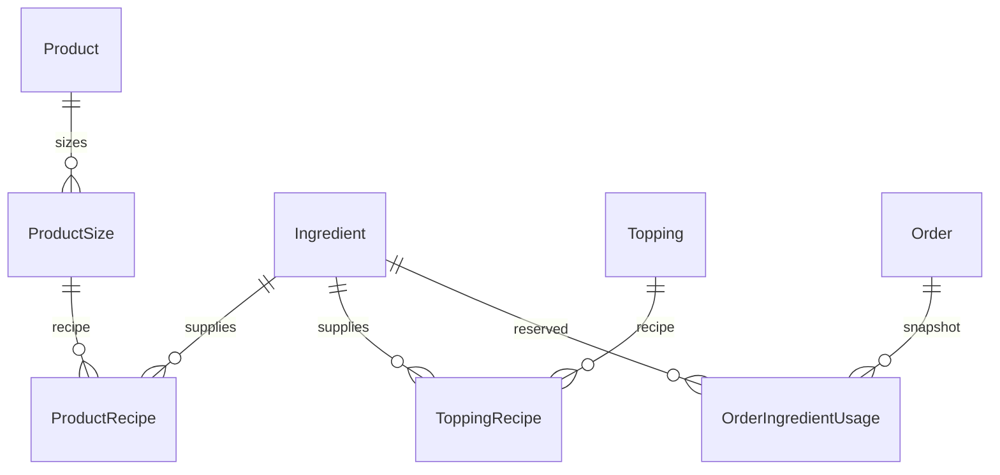

# Kho nguyên vật liệu — TV4, 2026-10-28

Đã triển khai schema, migration, định mức mỗi ly theo size, định mức topping, API nhân viên và giữ/hoàn kho trong transaction Orders. Dữ liệu mẫu dùng để chạy thử; định lượng thực tế của quán cần được nhập qua API. Nhánh giữ nguyên `feature/orders-and-inventory`.

## Database

| Bảng | Dữ liệu và ý nghĩa |
|---|---|
| `ingredients` | UUID, tên duy nhất, đơn vị `G`/`ML`/`PIECE`, `stock` khả dụng, `version` chống ghi đồng thời |
| `product_recipes` | Khóa `(product_size_id, ingredient_id)`, `amount` cần cho **một ly** của size đó |
| `topping_recipes` | Khóa `(topping_id, ingredient_id)`, `amount` cần cho **một phần topping** |
| `order_ingredient_usage` | Khóa `(order_id, ingredient_id)`, tổng `amount` đã tính cho đơn; snapshot không tính lại khi công thức thay đổi |
| `orders.ingredient_inventory` | Đơn mới do Orders API tạo là `true`; đơn trước migration giữ `false` để không hoàn/trừ nguyên liệu chưa từng được giữ |

Tồn và định mức dùng `Decimal(12,3)`, tính bằng `Prisma.Decimal`; PostgreSQL chặn tồn âm, định mức không dương và NaN. API nhận tối đa ba chữ số thập phân; giá trị Decimal trả dưới dạng chuỗi JSON. Cùng một nguyên liệu luôn dùng một đơn vị cơ sở: ví dụ nhập 2 lít sữa thành `2000 ML`. API không đổi đơn vị của nguyên liệu đã được sử dụng.



## Tính một ly và topping

Với từng nguyên liệu:

`Nhu cầu đơn = Σ dòng [số ly × (định mức size + Σ định mức topping đã chọn)]`

Theo contract giỏ hiện có, mỗi ID trong `toppingIds` là **một phần topping trên mỗi ly**; ID trùng bị từ chối. Hai topping khác nhau đều được cộng; tăng số ly nhân cả nguyên liệu gốc và topping. Chưa có bộ chọn nhiều phần của cùng một topping trên một ly. Tùy chọn đá/đường và ghi chú vẫn giữ contract hiện tại; định mức hiện cấu hình theo size/topping, chưa tự nhân theo phần trăm đá/đường.

Ví dụ dữ liệu seed: Bạc xỉu M = 20 g cà phê + 30 ml sữa tươi + 25 ml sữa đặc. Topping espresso = 10 g cà phê; topping cheese = 20 g kem cheese + 15 ml sữa tươi.

| Đặt 2 ly M, mỗi ly thêm espresso và cheese | Tổng giữ kho |
|---|---:|
| Cà phê | `2 × (20 + 10) = 60 g` |
| Sữa tươi | `2 × (30 + 15) = 90 ml` |
| Sữa đặc | `2 × 25 = 50 ml` |
| Kem cheese | `2 × 20 = 40 g` |

Một giỏ có nhiều món dùng chung sữa sẽ cộng dồn vào một nhu cầu sữa. Không kiểm riêng từng món rồi cho phép tổng vượt kho.

## Thời điểm tác động kho

| Sự kiện | Tác động |
|---|---|
| Chọn topping/thay số ly trong giỏ | Chỉ thay cấu hình dự kiến; chưa tạo reservation |
| `POST /orders` | Backend tính lại toàn bộ; giữ Product stock hiện có và nguyên liệu, lưu snapshot cùng Order/items/history trong một transaction |
| Thiếu công thức size/topping hoặc thiếu bất kỳ nguyên liệu | HTTP 409; rollback toàn bộ, không có đơn hoặc kho bị trừ một phần |
| Hai đơn tranh nguyên liệu | Kiểm `version` và `stock >= amount`, cập nhật có điều kiện theo cùng thứ tự UUID; bên thua nhận 409 |
| PAID → PREPARING → READY → COMPLETED | Không trừ nguyên liệu lần nữa |
| PAYMENT_FAILED hoặc hủy trước pha | Sau khi thắng CAS của Order, hoàn đúng snapshot một lần |
| PAYMENT_FAILED → PENDING | Giữ lại **snapshot gốc**, không dùng công thức mới; thiếu kho thì rollback trạng thái và Product stock |
| Hủy từ PREPARING | Nguyên liệu được xem là đã dùng, không cộng lại vào kho khả dụng; lưu CANCELLED/reason như trước. Product stock cũ vẫn được hoàn theo contract hiện hành |
| UNKNOWN/PROCESSING | Không tự hoàn kho; chỉ kết quả thanh toán xác minh mới chuyển trạng thái |

`Product.stock` được giữ làm giới hạn bán hiện có để tương thích TV2/đơn cũ. Vì vậy món phải đủ **cả** Product stock và nguyên liệu. Không tự chuyển số ly tồn cũ thành lượng nguyên liệu. API catalog trả `stock = min(Product.stock, số ly tối đa có thể pha ở các size đang bán)`; từng size/topping được đánh dấu unavailable nếu thiếu công thức hoặc không đủ cho một phần. Khả năng còn hàng khi xem menu là dự báo, không giữ chỗ và không bảo đảm tổ hợp món+topping còn đủ lúc đặt.

## API nhân viên

Tất cả đường dẫn có tiền tố `/api`, dùng cookie Auth thật và role BARISTA; CUSTOMER nhận 403, chưa đăng nhập nhận 401. Các lệnh ghi chịu Origin guard như Orders.

| Endpoint | Body / kết quả |
|---|---|
| `GET /staff/inventory` | Danh sách nguyên liệu, tồn khả dụng, đơn vị, version |
| `POST /staff/inventory` | `{ "name": "Sữa tươi", "unit": "ML", "stock": 2000 }`; tên trùng trả 409 |
| `POST /staff/inventory/:id/receipts` | `{ "amount": 1000 }`; cộng thêm lượng nhập và tăng version nguyên tử |
| `GET /staff/inventory/recipes` | Danh sách size/topping kèm công thức và nguyên liệu |
| `PUT /staff/inventory/product-sizes/:id/recipe` | `{ "ingredients": [{ "ingredientId": "<uuid>", "amount": 30 }] }` |
| `PUT /staff/inventory/toppings/:id/recipe` | Cùng body; định mức cho một phần topping |

PUT thay toàn bộ công thức của size/topping trong transaction và khóa bản ghi cha, tránh hai lần sửa đồng thời trộn công thức. Không nhận danh sách rỗng, nguyên liệu trùng/không tồn tại, lượng âm/0 hoặc quá ba số lẻ. Công thức đã sửa chỉ áp dụng đơn mới. API nhập kho là phép cộng, **không có idempotency key**; không tự replay khi mất phản hồi.

Không có UI quản lý kho mới ở lượt này; quản lý bằng API. Frontend giỏ/checkout hiện tại gửi size, topping và số ly như trước; lỗi 409 tiếp tục hiển thị qua adapter sẵn có. Auth và mock không thay đổi.

## Seed và vận hành

- Migration nguyên liệu: `backend/prisma/migrations/20261028000000_ingredient_inventory/migration.sql`.
- Bổ sung migration `20261027000000_promotion_schema` cho model Promotion vốn đã có trong schema nhưng chưa có migration. Không đổi logic ưu đãi của TV6. Test Orders dùng fixture promotion trong DB thay vì mặc định mã demo luôn tồn tại.
- `seed-ingredients.ts`: 17 nguyên liệu, công thức 30 size của 10 món mẫu và 2 topping; size S/M/L dùng hệ số minh họa 0.75/1/1.25. Không đặt lại stock và không ghi đè công thức đã có khi chạy lại. Không đưa công thức mẫu vào production qua seed mặc định.
- Full `prisma:seed` thêm nguyên liệu trong môi trường phát triển. `prisma:seed-inventory` chỉ bổ sung customization/nguyên liệu cho catalog mẫu hiện có, không tạo tài khoản Auth.

Trong PowerShell, từ thư mục `backend` (nạp `.env` của repo, không in credential):

```powershell
$env:DOTENV_CONFIG_PATH='../.env'
node -r dotenv/config node_modules/prisma/build/index.js migrate deploy
node -r dotenv/config node_modules/tsx/dist/cli.mjs prisma/seed-inventory.ts
npm.cmd run test:ingredients:postgres
```

## Bằng chứng ngày 2026-10-28

- Runner tạo database UUID riêng, áp **16 migrations**, chạy **28 suites / 335 tests PASS, 0 skipped**, rồi xóa đúng database do runner tạo. Bao gồm định mức, nhiều size/topping, chung nguyên liệu, tranh kho khác sản phẩm, rollback, retry/snapshot, hủy sau pha, RBAC/validation, catalog, seed chạy lại và Payment PostgreSQL.
- Frontend **23/23 unit tests PASS**. Backend full test typecheck PASS sau khi bổ sung trường fixture/type còn thiếu trong test Payment cũ; không đổi logic Payment.
- Đã áp migration vào `localhost:5434/brewlite`, thêm **17 nguyên liệu / 30 size có công thức / 2 topping có công thức**. Ba đơn trước migration vẫn giữ `ingredient_inventory=false`; không tự trừ bù nguyên liệu cho đơn lịch sử.
- Preflight local không có orphan Payment, live attempt trùng hoặc Payment PROCESSING cũ cần đổi trạng thái. Migration Orders `20261015000100_orders_inventory` có checksum lịch sử khác file hiện tại; đã đối chiếu cột và constraint thực tế trước deploy. Giữ nguyên `_prisma_migrations` và file migration cũ; không reset DB. Việc deploy migration mới không xóa sự khác biệt lịch sử này.
- Không dùng kết quả này xác nhận VNPAY callback thật hoặc toàn bộ UI/Task của nhóm đã VERIFIED_COMPLETE. Công thức mẫu chưa phải định lượng được quán xác nhận.
