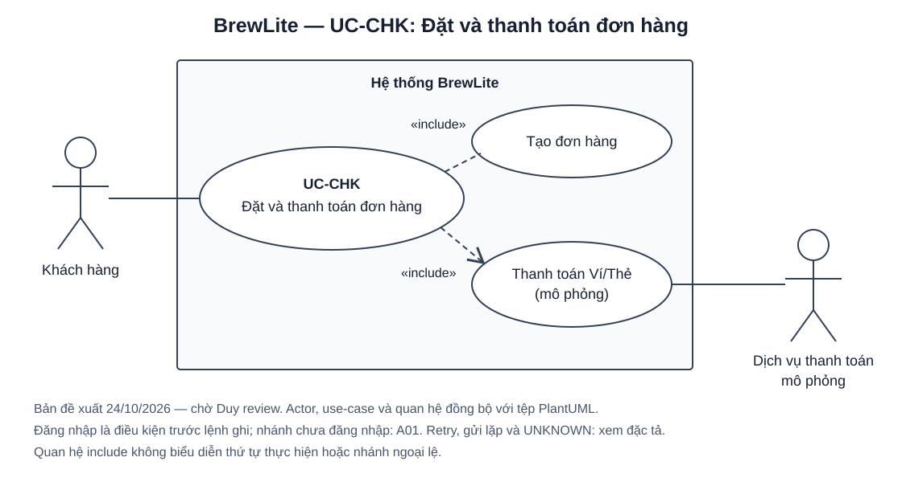

# Task 1.3 — Đặc tả use-case Đặt và thanh toán đơn hàng

| Thông tin | Nội dung |
|---|---|
| Dự án | BrewLite — Assignment 2, Requirements to Deployment |
| Mã use-case | UC-CHK |
| Người phụ trách đặc tả | Lê Quang Điệp |
| Phối hợp | Trần Thế Duy: sơ đồ use-case; Nguyễn Văn Đông: review chéo và nghiệp vụ tạo đơn/xác thực; Võ Minh Tri: SRS và checkout |
| Ngày soạn / phiên bản | 24/10/2026 / 0.1 |
| Trạng thái | DRAFT_READY_FOR_REVIEW — đã soạn đặc tả; chờ ghép SRS và review của nhóm |
| Mức | Mục tiêu người dùng; use-case trọng tâm của Task 1.3 |

## 1. Căn cứ và cách sử dụng

- **Đề chính thức:** `Assignment2-BrewLite (2).pdf`, mục 3.3 (trang in 3): sơ đồ phạm vi use-case, actor, trigger, tiền/hậu điều kiện, luồng chính/thay thế/ngoại lệ và liên kết mã yêu cầu. Mục 4.2 và 7.1–7.2 yêu cầu tiếp tục dùng luồng này cho sequence, triển khai và kiểm thử.
- **Phân công nhóm:** `BrewLite_Phan_cong_6_thanh_vien.docx`, bảng Task 1: Điệp viết đặc tả; Duy vẽ sơ đồ; Đông–Điệp kiểm tra chéo; hoàn thiện/nghiệm thu dự kiến ngày 25/10/2026 sau khi Task 1.1–1.2 được chốt. Đây là kế hoạch nhóm, không phải ngày do PDF quy định.
- **Đồ án kế thừa:** [API contract](../API_CONTRACT.md), [yêu cầu miền Order/Inventory/Staff bản nháp](tv4-order-inventory-staff.md), mã nguồn tạo đơn/thanh toán và checkout liệt kê ở mục 12. Hành vi retry tham chiếu mục **Payment consistency — 2026-10-17** và mã nguồn, vì contract còn giữ mô tả retry cũ khác với cập nhật này.

Tài liệu này là bản đặc tả để nhóm review, không phải báo cáo đã chạy kiểm thử. Chưa tìm thấy SRS toàn nhóm đã duyệt trong repo tại thời điểm soạn. Mã FR/NFR kế thừa và mã đề xuất cục bộ được phân biệt ở mục 10; không tự coi chúng là mã SRS đã chốt. Phân công trong tài liệu này theo DOCX người dùng vừa cung cấp, thay cho phân công UC-CHK cũ trong bộ nháp ngày 21/10.

## 2. Mục tiêu và phạm vi

**User story:** Là khách hàng, tôi muốn đặt các món đã chọn và thanh toán bằng Ví hoặc Thẻ mô phỏng để nhận mã đơn, biết kết quả thanh toán và tiếp tục theo dõi đơn của mình.

Use-case bắt đầu khi khách từ giỏ hàng chọn tiếp tục đặt đơn. Use-case kết thúc khi hệ thống thông báo kết quả xác định, khách dừng thao tác, hoặc hệ thống thông báo chưa xác định được kết quả và hướng dẫn kiểm tra đơn. Xem menu và chọn size/topping là các bước trước use-case; lịch sử/theo dõi đơn là luồng tiếp nối.

| Trong phạm vi UC-CHK | Ngoài phạm vi UC-CHK |
|---|---|
| Kiểm tra đăng nhập, giỏ và cấu hình món; tính giá phía server; kiểm tra/giữ tồn kho; tạo đơn PENDING | Đặc tả đầy đủ đăng ký/đăng nhập, duyệt menu và chỉnh sửa giỏ |
| Chọn WALLET hoặc CARD; thanh toán mô phỏng; ghi nhận kết quả; chống xử lý lặp | Thu/hoàn tiền thật, nhập/lưu thông tin thẻ ngân hàng thật, giao hàng tận nơi |
| Thông báo thành công/thất bại/chưa xác định; thanh toán lại đơn thất bại; cung cấp mã đơn và đường dẫn theo dõi | Quy trình pha chế/bàn giao, hủy đơn/hoàn tiền, vận hành đối soát tự động |
| Tôn trọng giá và mức giảm đã được backend xác nhận nếu SRS có khuyến mãi | Tự bổ sung yêu cầu khuyến mãi/tích điểm; các phần này cần scope riêng trong SRS |

## 3. Actor, trigger và điều kiện

### Actor

| Actor | Vai trò |
|---|---|
| Khách hàng — actor chính | Kiểm tra giỏ, đăng nhập khi cần, chọn phương thức, xác nhận đặt/thanh toán và xem kết quả |
| Dịch vụ thanh toán mô phỏng — actor hỗ trợ | Nhận yêu cầu thanh toán và trả kết quả PAID, PAYMENT_FAILED hoặc UNKNOWN |

Next.js UI, NestJS API và PostgreSQL là thành phần bên trong hệ thống, không phải actor người dùng. Dịch vụ thanh toán được biểu diễn ngoài ranh giới nghiệp vụ BrewLite theo vai trò hệ thống hỗ trợ; gateway mô phỏng hiện có có thể chạy cùng ứng dụng, không bắt buộc tách container. Nhân viên quầy không trực tiếp tham gia UC-CHK.

**Trigger:** Khách chọn tiếp tục đặt đơn từ giỏ hàng; với luồng A02, khách chọn “Thử thanh toán lại” từ đơn đã xác nhận thất bại.

### Tiền điều kiện

1. Khách đã chọn ít nhất một món và cấu hình mong muốn vào giỏ; server sẽ kiểm tra lại tính hợp lệ, giá và tồn kho khi nhận yêu cầu.
2. Hệ thống có dữ liệu sản phẩm/size/topping và hỗ trợ hai phương thức mô phỏng WALLET/CARD.
3. Luồng chính áp dụng khi khách đã có phiên CUSTOMER hợp lệ. Khách chưa đăng nhập đi qua A01; đăng nhập là điều kiện bắt buộc **trước khi ghi đơn hoặc thanh toán**.
4. Luồng chính giả định các dịch vụ cần thiết sẵn sàng; lỗi dịch vụ được xử lý theo các ngoại lệ, không coi đây là bằng chứng khách đã thanh toán thất bại.

### Hậu điều kiện

| Kết quả | Trạng thái được bảo đảm |
|---|---|
| Thành công | Đơn thuộc đúng khách; dữ liệu món và giá được lưu dưới dạng snapshot; Payment PAID và Order PAID được ghi nhất quán; tồn kho đã giữ không bị trừ thêm; khách thấy mã đơn, tổng tiền, phương thức và kết quả, có thể mở đơn để theo dõi |
| Bị từ chối trước khi tạo đơn | Không tạo Order/Payment và không làm thay đổi tồn kho do yêu cầu bị từ chối; khách nhận lý do để chỉnh sửa hoặc đăng nhập |
| Thanh toán thất bại đã xác định | Đơn vẫn tồn tại với PAYMENT_FAILED; kết quả Payment được lưu; lượng tồn kho đã giữ được hoàn đúng một lần; không thông báo thành công; giữ giỏ để khách xử lý tiếp |
| Thanh toán chưa xác định/đang xử lý | Không tự kết luận PAID hoặc PAYMENT_FAILED; khi backend chưa áp kết quả xác định, Order giữ PENDING và giữ kho; không phát sinh lần thanh toán mới để vượt lần đang chờ; giữ thông tin đơn và lần thanh toán để kiểm tra lại |

Nếu chỉ trình duyệt mất phản hồi, backend có thể đã hoàn tất. Hậu điều kiện thực tế phải đọc lại từ server; màn hình “chưa xác định” không phải một trạng thái Order mới. Nếu lỗi transaction tạo đơn thì rollback toàn bộ việc tạo đơn/giữ kho; không xóa một đơn đã tạo thành công chỉ vì thanh toán xảy ra lỗi sau đó.

## 4. Luồng chính — Đặt đơn và thanh toán thành công

| Bước | Khách hàng / actor hỗ trợ | Phản hồi và xử lý của BrewLite |
|---|---|---|
| M01 | Khách chọn tiếp tục đặt đơn từ giỏ. | Kiểm tra phiên CUSTOMER; hiển thị checkout với món, tùy chọn, số lượng và tổng tiền hiện tại. Chưa có phiên → A01; giỏ không hợp lệ → E01. |
| M02 | Khách kiểm tra thông tin, chọn Ví (WALLET) hoặc Thẻ (CARD) mô phỏng. | Hiển thị phương thức đã chọn và cho phép quay về sửa giỏ trước khi xác nhận. Không yêu cầu dữ liệu ngân hàng thật. |
| M03 | Khách xác nhận đặt và thanh toán. | Khóa thao tác gửi lặp trên giao diện trong lúc xử lý; gửi cấu hình món đến backend. Backend kiểm tra lại phiên, quyền và dữ liệu. Phiên lỗi → A01/E04. |
| M04 | — | Backend tra sản phẩm/tùy chọn, tính giá chính thức, kiểm tra mức giảm nếu có; cộng tổng số lượng theo sản phẩm để kiểm tra tồn kho. Dữ liệu lỗi → E01; thiếu kho → E02. |
| M05 | — | Trong một transaction, giữ tồn kho và lưu Order PENDING, OrderItem/snapshot, lịch sử ban đầu. Commit thành công rồi trả mã đơn và tổng tiền chính thức. Lỗi ghi dữ liệu → E03. Chưa xóa giỏ ở bước này. |
| M06 | — | Ghi nhận orderId; tạo/lưu khóa idempotency cho lần thanh toán và gửi orderId, phương thức, khóa đến backend. Giá trị thanh toán được lấy từ Order, không lấy từ giá do client gửi. |
| M07 | — | Backend kiểm tra chủ đơn, trạng thái và khóa idempotency. Ghi nhận lần thanh toán đang xử lý trước khi gọi dịch vụ mô phỏng. Yêu cầu gửi lại → A03; khóa/xung đột không hợp lệ → E05. |
| M08 | Dịch vụ thanh toán mô phỏng trả PAID. | Tiếp nhận kết quả có thẩm quyền. Kết quả PAYMENT_FAILED → A02; timeout/UNKNOWN → E06. Không giữ transaction DB mở trong lúc chờ dịch vụ thanh toán. |
| M09 | — | Ghi kết quả Payment PAID, chuyển Order PENDING → PAID và ghi lịch sử trong cùng transaction áp dụng kết quả. Không trừ thêm tồn kho đã giữ, không áp dụng lại tác động khi replay. Lỗi áp dụng kết quả → E07. |
| M10 | Khách nhận thông báo và có thể mở đơn để theo dõi. | Hiển thị thành công với mã đơn, tổng tiền chính thức, phương thức; dọn giỏ theo luồng thanh toán thành công của ứng dụng. Chỉ báo đã thanh toán sau khi backend xác nhận. Kết thúc UC-CHK; theo dõi/lịch sử là use-case tiếp nối. |

## 5. Luồng thay thế

### A01 — Chưa đăng nhập hoặc phiên hết hạn

- **Điểm rẽ:** M01 hoặc M03; cũng áp dụng trước khi gửi Payment ở M06.
- Hệ thống yêu cầu đăng nhập; khách có thể đăng ký qua luồng riêng nếu chưa có tài khoản. Không dùng xác thực giả lập.
- Sau đăng nhập, tải/kiểm tra lại giỏ hoặc đơn đã biết và quyền sở hữu. Nếu chưa tạo đơn, quay lại M01. Nếu đã biết orderId, kiểm tra trạng thái đơn/lần thanh toán trước khi tiếp tục, không tự tạo đơn mới.
- Nếu khách hủy đăng nhập hoặc xác thực thất bại, dừng thao tác ghi; không tạo đơn/thanh toán từ request chưa được xác thực.
- Việc quay lại đúng đơn khi phiên hết hạn giữa thanh toán cần kiểm chứng trong tích hợp; không coi chỉ có tham số chuyển hướng là đã đáp ứng yêu cầu.

### A02 — Thanh toán thất bại và khách chọn thử lại

- **Điểm rẽ:** M08, khi dịch vụ xác nhận PAYMENT_FAILED.
- Hệ thống lưu thất bại, chuyển Order PENDING → PAYMENT_FAILED và hoàn tồn kho đã giữ đúng một lần; hiển thị mã đơn và lựa chọn thử lại.
- Nếu khách dừng, kết thúc với hậu điều kiện thất bại. Nếu thử lại, tải lại **cùng orderId**, xác minh chủ đơn và trạng thái PAYMENT_FAILED; hiển thị snapshot món/tổng tiền của đơn cũ.
- Khách có thể chọn lại WALLET/CARD. Lần thử mới dùng **khóa idempotency mới**; không gọi tạo Order mới. Đổi món là một quy trình đặt đơn khác, không sửa snapshot của đơn cũ.
- Trước khi gọi gateway, backend kiểm tra và giữ lại tồn kho, chuyển PAYMENT_FAILED → PENDING và ghi nhận attempt trong một transaction. Thiếu kho → E02: vẫn PAYMENT_FAILED, không commit attempt mới, không gọi gateway.
- Sau khi chuẩn bị thành công, tiếp tục M08–M10; có thể nhận thất bại lần nữa hoặc UNKNOWN. Tổng tiền lấy từ đơn cũ, không tính lại theo giá catalog đã đổi.

### A03 — Gửi lại cùng yêu cầu thanh toán

- **Điểm rẽ:** M07; xảy ra khi reload, mất phản hồi hoặc gửi lặp.
- Gửi lại cùng người dùng, orderId, phương thức và **khóa cũ** để nhận kết quả của cùng lần thanh toán.
- Nếu kết quả đã lưu, trả kết quả cũ; không gọi gateway, cập nhật trạng thái, tác động kho hoặc cộng điểm (nếu có) lần nữa. Payment thất bại với khóa cũ vẫn trả thất bại; chỉ A02 mới mở lần thử mới.
- Nếu đang xử lý/chưa có kết quả đủ để hoàn tất, phản hồi đang xử lý/xung đột; giữ khóa cũ để kiểm tra lại. Nếu đã lưu kết quả gateway nhưng chưa áp dụng vào đơn, thực hiện E07.
- Dùng lại khóa với orderId/phương thức khác → E05. Dùng khóa mới cho đơn đang có lần PROCESSING/UNKNOWN hoặc đã PAID cũng không được tạo thêm giao dịch.

### A04 — Khách quay lại sửa giỏ hoặc rời checkout

- **Điểm rẽ:** Trước M03: khách về giỏ để sửa món/số lượng; khi tiếp tục thì bắt đầu lại M01. Chưa có đơn nên chưa giữ tồn kho cho đơn.
- Sau M05, việc đóng trang không tự hủy đơn hoặc tự hoàn kho. Nếu đã có orderId, kiểm tra đơn đó khi quay lại. Chính sách hết hạn đơn PENDING chưa được chốt (Q04, mục 11).

## 6. Luồng ngoại lệ

| Mã / điểm rẽ | Tình huống | Cách xử lý và điểm tiếp tục/kết thúc |
|---|---|---|
| E01 / M01, M04 | Giỏ rỗng; số lượng sai; sản phẩm không tồn tại; size/topping không hợp lệ/ngừng bán; dữ liệu giả giá/chủ đơn/trạng thái | Báo dữ liệu cần sửa; không tạo đơn hoặc giữ kho. Khách sửa giỏ rồi quay M01. Với mã khuyến mãi không hợp lệ, yêu cầu bỏ/sửa mã nếu SRS bật chức năng này. |
| E02 / M04–M05, A02 | Hết hàng, tổng số lượng các dòng cùng sản phẩm vượt tồn kho, hoặc khách khác vừa mua phần kho cuối | Từ chối toàn bộ đơn/lần retry, không giữ kho một phần. Khách tải lại và sửa giỏ; retry đơn cũ thì giữ PAYMENT_FAILED và không gọi gateway. Không bảo đảm thành công chỉ vì lúc xem menu còn hàng. |
| E03 / M05 | DB lỗi trong transaction tạo đơn hoặc mất phản hồi sau khi gửi tạo đơn | Nếu transaction thất bại: rollback Order/items/history/kho. Nếu chỉ mất phản hồi: UI báo chưa xác định tạo đơn thành công hay chưa, không tự gửi lại POST /orders; kiểm tra lịch sử/đơn trước khi quyết định đặt tiếp. Chưa có cơ chế bảo đảm chống trùng tạo đơn trong contract hiện tại (Q03). |
| E04 / M03, M07 | Phiên không hợp lệ, tài khoản không có quyền, thanh toán/đọc đơn người khác | Yêu cầu đăng nhập nếu thiếu phiên; từ chối quyền/ownership còn lại, không lộ dữ liệu đơn người khác và không tạo Payment/đổi kho. Không coi biết orderId là có quyền truy cập. |
| E05 / M07 | Khóa cũ gắn order/phương thức khác; đơn đã thanh toán/hủy/không được phép trả tiền; có lần thanh toán khác đang chờ | Từ chối xung đột; tải lại trạng thái và xử lý theo kết quả có thẩm quyền. Không tạo khóa khác liên tục để vượt kiểm tra. |
| E06 / M08 hoặc khi UI chờ | Gateway timeout/UNKNOWN, mạng lỗi, trình duyệt không nhận được phản hồi | Hiển thị chưa xác định; không hiển thị thành công hoặc thất bại chắc chắn chỉ từ timeout. Kiểm tra đơn từ backend; cùng attempt thì giữ khóa cũ. UNKNOWN/PROCESSING chưa được giải quyết không cho thanh toán lần mới. Backend chưa có API đối soát tự động; việc chờ lâu không tự giải phóng kho hay đổi trạng thái (Q04). |
| E07 / M09 | Đã có kết quả gateway nhưng transaction cập nhật Payment/Order thất bại | Rollback việc áp kết quả, không commit trạng thái nghiệp vụ dang dở. Với kết quả gateway đã lưu bền vững, gửi lại khóa cũ có thể phục hồi áp dụng một lần mà không gọi gateway lại. Nếu chưa lưu được kết quả gateway, giữ trạng thái chờ và cần xác minh; không tự thanh toán lại. |
| E08 / M10 | Thanh toán đã PAID nhưng tải màn kết quả hoặc dọn giỏ lỗi | Đơn vẫn PAID; tải lại chi tiết/lịch sử của chủ đơn để hiển thị kết quả. Không tạo thanh toán mới vì lỗi giao diện; việc dọn giỏ có thể thử lại mà không thay kết quả thanh toán. |

## 7. Quy tắc nghiệp vụ

| Mã | Quy tắc |
|---|---|
| BR-CHK-01 | Backend lấy người dùng từ phiên xác thực; khách chỉ tạo/thanh toán/đọc đơn của mình. Client không được tự khai giá, chủ đơn hoặc trạng thái thanh toán. |
| BR-CHK-02 | Tiền là số nguyên VND. Đơn giá = giá sản phẩm + phụ thu size + tổng phụ thu topping; thành tiền dòng = đơn giá × số lượng; tổng đơn = tổng các dòng − mức giảm hợp lệ nếu có. Backend quyết định giá chính thức; snapshot đơn đã tạo không đổi theo catalog. |
| BR-CHK-03 | Kiểm tổng quantity của các dòng cùng Product. Tạo đơn và giữ kho phải nguyên tử, không âm kho. PAID không trừ kho thêm. PAYMENT_FAILED hoàn đúng lượng đã giữ một lần. Retry phải giữ kho lại trước gateway. |
| BR-CHK-04 | PENDING chỉ có nghĩa đã tạo đơn, chưa có nghĩa đã thanh toán. UNKNOWN là kết quả Payment, không phải enum Order. PROCESSING là trạng thái nội bộ của lần thanh toán. |
| BR-CHK-05 | Thanh toán mô phỏng bằng WALLET/CARD. Không yêu cầu tiền thật hoặc dữ liệu thẻ thật. Nút chọn kịch bản PAID/FAILED/UNKNOWN chỉ là điều khiển sandbox, không phải quyền của khách tự xác nhận đã trả tiền. |
| BR-CHK-06 | Cùng user + key + order + method là cùng lần thanh toán. Chỉ bắt đầu lần mới bằng key mới sau khi đã xác định lần trước thất bại. Idempotency Payment không đồng nghĩa idempotency tạo Order. |
| BR-CHK-07 | Kết quả Payment và các tác động Order/kho/history phải nhất quán khi áp kết quả; gateway chạy ngoài transaction DB. Không giả định có thể rollback một giao dịch bên ngoài chỉ bằng rollback DB. |
| BR-CHK-08 | Chỉ báo thành công khi có xác nhận backend. Giỏ chưa bị xóa khi mới PENDING hoặc khi thanh toán thất bại/chưa rõ; retry dùng snapshot đơn cũ. Chính sách dọn giỏ khi có chỉnh sửa đồng thời cần được nhóm chốt (Q05). |

### Phân biệt trạng thái trong phạm vi use-case

| Sự kiện | Order | Payment | Tồn kho |
|---|---|---|---|
| Tạo đơn thành công, chưa gọi thanh toán | PENDING | Chưa có | Đã giữ |
| Bắt đầu thanh toán | PENDING | PROCESSING (nội bộ) | Giữ nguyên |
| Xác nhận thanh toán thành công | PAID | PAID | Không trừ thêm |
| Xác nhận thất bại | PAYMENT_FAILED | PAYMENT_FAILED | Hoàn một lần |
| Gateway chưa xác định | PENDING | UNKNOWN | Tiếp tục giữ |
| Chuẩn bị retry thành công | PAYMENT_FAILED → PENDING | Attempt mới PROCESSING; giữ attempt cũ thất bại | Giữ lại trước gateway |
| Retry thiếu kho | PAYMENT_FAILED | Không commit attempt mới | Không đổi |

Các trạng thái PREPARING/READY/COMPLETED thuộc xử lý đơn sau thanh toán. Use-case này không cấp quyền cho khách tự chuyển sang các trạng thái đó.

## 8. Sơ đồ use-case phạm vi trọng tâm

- [Nguồn PlantUML](../diagrams/use-case-checkout-draft.puml) và [bản SVG](../diagrams/use-case-checkout-draft.svg) mô tả cùng actor, ranh giới và quan hệ.
- [Bản PNG](../diagrams/use-case-checkout-draft.png) được kết xuất từ SVG để chèn vào báo cáo. SVG được dựng cùng nội dung với nguồn PlantUML; không phải kết quả chạy trình biên dịch PlantUML.
- UC-CHK bao gồm hành vi tạo đơn và thanh toán mô phỏng. Quan hệ `include` không mô tả thứ tự thời gian hay bảo đảm mọi ngoại lệ đều đi tới thanh toán; thứ tự và điểm dừng nằm ở mục 4–6, sau đó được thể hiện bằng activity/sequence ở Task 2.
- Đăng nhập, sửa giỏ và theo dõi là các use-case liên quan trước/sau, không đưa vào hình để tránh nhầm với sơ đồ tổng quát toàn hệ thống. Retry và UNKNOWN là các nhánh trong đặc tả này.
- Hình là bản đề xuất hỗ trợ bàn giao Task 1.3; **Duy vẫn phụ trách review/chuẩn hóa sơ đồ theo DOCX**. Chưa thay thế sơ đồ tổng quát của Task 1.2, chưa ghi nhận Duy đã phê duyệt.

## 9. Tiêu chí chấp nhận và ca kiểm thử dự kiến

Tất cả ca dưới đây có trạng thái **PLANNED**. Đây là kết quả mong đợi dùng để viết test ở Task 4–5, không phải log kiểm thử đã chạy.

| Mã AC / test dự kiến | Điều kiện và thao tác | Kết quả mong đợi | Luồng |
|---|---|---|---|
| AC-CHK-01 / CHK-T01 | CUSTOMER hợp lệ; giỏ đúng/còn hàng; gateway PAID. Chạy riêng WALLET và CARD. | Mỗi lần đặt mới có một Order và một Payment PAID, đúng snapshot/tổng tiền/phương thức; kho giảm đúng số lượng một lần; có màn xác nhận và mở được đơn. | M01–M10 |
| AC-CHK-02 / CHK-T02 | Khách chưa đăng nhập hoặc phiên hết hạn trước lệnh ghi. | Yêu cầu đăng nhập; không ghi nghiệp vụ từ request bị từ chối. Sau xác thực phải kiểm tra lại giỏ/đơn, không tự tạo đơn khác khi đã biết orderId. | A01 |
| AC-CHK-03 / CHK-T03 | Lần lượt gửi giỏ rỗng, quantity 0/không nguyên, size/topping sai, field tự đặt giá/user/status. | Bị từ chối; số Order/Payment và stock không đổi do request lỗi. | E01, E04 |
| AC-CHK-04 / CHK-T04 | Giá nền 29.000đ, phụ thu size 10.000đ, topping 6.000đ, quantity 2, không giảm giá; client dùng giá khác hoặc catalog đổi sau khi tạo. | Tổng chính thức 90.000đ; không nhận giá tự khai. Snapshot đã tạo và số tiền retry vẫn 90.000đ khi catalog đổi. | M04–M06, A02 |
| AC-CHK-05 / CHK-T05 | Tồn kho 1; hai khách đồng thời đặt 1 ly, hoặc một giỏ có nhiều dòng cùng sản phẩm vượt kho. | Trường hợp tranh kho: đúng một đơn thành công, kho cuối 0. Giỏ vượt kho bị từ chối toàn bộ, không âm kho/giữ một phần. | E02 |
| AC-CHK-06 / CHK-T06 | Gây lỗi DB giữa giữ kho và hoàn tất tạo đơn. | Không còn Order/items/history dang dở; kho trở về trước request; không gọi gateway. | E03 |
| AC-CHK-07 / CHK-T07 | Gateway trả PAYMENT_FAILED; khách xem lại đơn rồi retry thành công bằng key mới. | Lần đầu hoàn kho một lần và giữ giỏ; lần sau cùng orderId, giữ kho lại trước gateway, Order PAID; lưu hai attempts với kết quả tương ứng. | A02 |
| AC-CHK-08 / CHK-T08 | Gửi lại cùng payment key/order/method sau PAID và sau PAYMENT_FAILED; thử cả hai request đồng thời. | Chỉ một lần gọi gateway cho attempt; replay trả kết quả đã lưu hoặc báo đang xử lý; không lặp transition/kho. Key cũ thất bại không tạo lần charge mới. | A03 |
| AC-CHK-09 / CHK-T09 | Dùng key cũ cho phương thức/đơn khác; dùng key mới khi đơn đang PROCESSING/UNKNOWN hoặc đã PAID. | Từ chối xung đột; không tạo thêm giao dịch hoặc tác động kho. | E05 |
| AC-CHK-10 / CHK-T10 | Gateway timeout/UNKNOWN hoặc UI mất phản hồi dù backend đã PAID. | UNKNOWN giữ PENDING/kho, không mở attempt mới. Trường hợp backend đã PAID: tải lại hiển thị PAID; không suy ra thất bại từ lỗi mạng. | E06, E08 |
| AC-CHK-11 / CHK-T11 | Sau PAYMENT_FAILED, sản phẩm không còn đủ kho khi retry. | Cùng đơn vẫn PAYMENT_FAILED; không commit attempt mới, không gọi gateway, không thay kho. | A02, E02 |
| AC-CHK-12 / CHK-T12 | Khách B đọc/thanh toán đơn khách A; gọi tạo đơn bằng tài khoản không được phép. | Không lộ dữ liệu/không ghi nghiệp vụ trái quyền; phản hồi theo Auth/ownership contract. | E04 |
| AC-CHK-13 / CHK-T13 | Lưu kết quả gateway thành công rồi gây lỗi transaction áp kết quả; gửi lại key cũ. | Lần lỗi không commit Payment/Order dang dở; replay phục hồi từ kết quả đã lưu, gateway không gọi thêm, tác động nghiệp vụ đúng một lần. | E07 |
| AC-CHK-14 / CHK-T14 | Mất phản hồi POST /orders hoặc đóng trang sau khi đã tạo đơn. | Không tự lặp POST /orders hay tự hủy/hoàn kho; hướng dẫn kiểm tra lịch sử. Cách xác định duy nhất đơn khi mất orderId còn chờ Q03. | E03, A04 |
| AC-CHK-15 / CHK-T15 | Tải lại màn thành công/lịch sử sau thanh toán; giả lập lỗi dọn giỏ. | Kết quả lấy từ đơn của chủ sở hữu; đúng mã/tổng/phương thức; đơn vẫn PAID, không thanh toán lại vì giỏ chưa dọn. | M10, E08 |

## 10. Liên kết yêu cầu và truy vết

**Quy ước:** FR-05/08/10 và NFR-02/04 dưới đây đã có trong bản nháp miền TV4, chưa phải bằng chứng SRS toàn nhóm phê duyệt. Các mã `FR-CHK-*` là **đề xuất cục bộ** để truy vết được ngay; Tri/Đông cần thay hoặc ánh xạ sang FR chính thức sau khi ghép SRS. Không mặc định dùng một mã FR trong ví dụ của đề cho cùng nghiệp vụ.

| Mã / trạng thái mã | Yêu cầu liên quan UC-CHK | Bước/nhánh | AC |
|---|---|---|---|
| FR-CHK-01 / đề xuất cục bộ | Kiểm tra đăng nhập và quyền CUSTOMER trước đặt/thanh toán | M01, M03, M07, A01, E04 | AC-CHK-02, AC-CHK-12 |
| FR-CHK-02 / đề xuất cục bộ | Kiểm tra giỏ, tùy chọn, số lượng; hiển thị thông tin checkout | M01–M04, A04, E01 | AC-CHK-01, AC-CHK-03, AC-CHK-04 |
| FR-05 / kế thừa bản nháp | Tạo đơn, giá server, snapshot, transaction | M04–M06, E03 | AC-CHK-01, AC-CHK-03, AC-CHK-04, AC-CHK-06, AC-CHK-14 |
| FR-10 / kế thừa bản nháp | Kiểm tra/giữ/hoàn tồn kho, xử lý đồng thời | M04–M05, M09, A02, E02 | AC-CHK-05, AC-CHK-06, AC-CHK-07, AC-CHK-11 |
| FR-CHK-03 / đề xuất cục bộ | Thanh toán Ví/Thẻ mô phỏng và trả kết quả | M02, M06–M10, A02, E06–E08 | AC-CHK-01, AC-CHK-07, AC-CHK-10, AC-CHK-13, AC-CHK-15 |
| FR-CHK-04 / đề xuất cục bộ | Chống xử lý thanh toán lặp và phân biệt replay/retry | M06–M09, A02–A03, E05, E07 | AC-CHK-07, AC-CHK-08, AC-CHK-09, AC-CHK-11, AC-CHK-13 |
| FR-08 / kế thừa bản nháp | Cập nhật đúng trạng thái đơn theo kết quả Payment | M05, M09, A02, E06–E08 | AC-CHK-01, AC-CHK-07, AC-CHK-10, AC-CHK-13, AC-CHK-15 |
| FR-CHK-05 / đề xuất cục bộ | Tra cứu đơn/kết quả của chính khách, nối lịch sử/theo dõi | M10, A01, E03, E06, E08 | AC-CHK-12, AC-CHK-14, AC-CHK-15 |
| NFR-02 / kế thừa bản nháp | Xác thực và bảo vệ dữ liệu, chống giả mạo giá/owner/status | M03–M07, E01, E04 | AC-CHK-02, AC-CHK-03, AC-CHK-12 |
| NFR-04 / kế thừa bản nháp | Toàn vẹn giao dịch và dữ liệu khi lỗi/đồng thời | M05, M07–M09, A02–A03, E02–E03, E07 | AC-CHK-05, AC-CHK-06, AC-CHK-08, AC-CHK-11, AC-CHK-13 |

Ánh xạ test dùng cùng số: `AC-CHK-01 → CHK-T01`, …, `AC-CHK-15 → CHK-T15`. Các yêu cầu hiệu năng/khả dụng của SRS toàn hệ thống cần bổ sung sau khi có ngưỡng đo đã chốt; không tự đặt SLA cho nhóm trong Task 1.3.

## 11. Điểm cần nhóm chốt trước nghiệm thu

| Mã | Nội dung cần chốt | Người phối hợp / ảnh hưởng |
|---|---|---|
| Q01 | SRS Task 1.2, mã FR/NFR chính thức và phạm vi khuyến mãi/tích điểm | Tri/Đông/nhóm; hoàn tất mapping mục 10, không để mã đề xuất bị hiểu là mã đã duyệt |
| Q02 | Duy review sơ đồ; Đông review đặc tả, nhất quán tiền/hậu điều kiện và nhánh lỗi | Duy/Đông/Điệp; lưu nhận xét và commit/PR thật, chưa có người duyệt trong lượt soạn này |
| Q03 | Khi mất phản hồi tạo đơn và chưa biết orderId, cần cơ chế nào để nhận diện đúng đơn và ngăn tạo trùng | Đông/Điệp/Tri; contract hiện chưa có idempotency Order. Tra lịch sử chỉ hỗ trợ kiểm tra, không phải bảo đảm tự động chống trùng |
| Q04 | Xử lý đơn PENDING bị bỏ dở, PROCESSING/UNKNOWN kéo dài; có cần đối soát/hết hạn trong MVP không | Điệp/Đông/Kiệt; hiện chưa có TTL/API đối soát tự động. Không tự hứa tự phục hồi mọi trường hợp |
| Q05 | Nếu giá đổi giữa checkout và tạo đơn, có cần khách xác nhận lại trước thanh toán; dọn giỏ thế nào khi khách sửa giỏ ở tab khác | Tri/Đông/Điệp; code hiện dùng giá server và dọn giỏ sau PAID, chưa chứng minh có bước xác nhận lại giá hoặc bảo toàn món mới ở tab khác |

Các câu hỏi Q03–Q05 ghi rõ giới hạn và hành vi bảo thủ có thể đặc tả ngay; nhóm quyết định phạm vi bổ sung trước khi chốt baseline. Không tự nâng bản soạn thành VERIFIED_COMPLETE hoặc coi Task 1 toàn nhóm đã nghiệm thu.

## 12. Đối chiếu đồ án và bàn giao Task sau

| Tài liệu/mã nguồn tham khảo | Nội dung đã đối chiếu bằng cách đọc |
|---|---|
| [Orders service](../../backend/src/orders/orders.service.ts) | Giá server, snapshot, giữ kho/tạo đơn cùng transaction; lọc đơn theo chủ sở hữu; chuẩn bị retry |
| [Payments service](../../backend/src/payments/payments.service.ts) | Key theo user/order/method; chặn attempt trùng; gọi gateway ngoài transaction; journal và áp kết quả |
| [Checkout](../../frontend/src/app/checkout/page.tsx) | Chọn WALLET/CARD; tạo đơn; retry bằng cùng orderId và snapshot; chặn submit lặp ở giao diện |
| [Payment page](../../frontend/src/app/payment/[id]/[stage]/page.tsx) | Kết quả success/failure/unknown, kiểm tra lại đơn, dọn giỏ khi thành công, quay checkout khi retry |
| [API contract](../API_CONTRACT.md) | POST /orders, POST /payments, GET /orders/me, GET /orders/:id và quy ước trạng thái/ownership |

Việc đọc mã chỉ giúp đặc tả khớp đồ án; chưa xác nhận mọi nhánh UI/API đang đạt AC ở mục 9. Không thay endpoint/DTO hoặc code ứng dụng trong lượt này.

**Bàn giao Task 2:** Khôi/Tri dùng M01–M10, A01–A04 và E01–E08 để vẽ activity; Đông ghép sequence tạo đơn và Điệp ghép phần thanh toán/retry/idempotency; Duy dùng actor, trạng thái và dữ liệu liên quan để đồng bộ use-case/class. Sequence tối thiểu có Customer, Next.js UI, NestJS API, Database, Payment Service theo đề.

**Checklist trước nghiệm thu Task 1.3:**

- [x] Có mục tiêu, phạm vi, actor, trigger, tiền/hậu điều kiện.
- [x] Có luồng chính, thay thế và ngoại lệ với điểm rẽ/kết thúc.
- [x] Có bản đề xuất sơ đồ trọng tâm, nguồn PlantUML và SVG.
- [x] Có quy tắc nghiệp vụ, tiêu chí chấp nhận và truy vết dự kiến.
- [ ] Ghép mã FR/NFR chính thức với SRS đã duyệt.
- [ ] Duy/Đông review và nhóm chốt các quyết định ảnh hưởng scope/AC.
- [ ] Lưu commit/PR và biên bản nghiệm thu thật; không tự điền người duyệt/link giả.

Task 1 toàn nhóm còn cần context/scope, SRS và sơ đồ use-case tổng quát. Bộ Task 1.3 này không thay thế các tạo phẩm đó.
